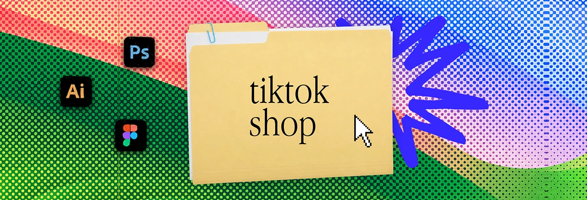

# Rainbow halftone banner with a 'tiktok shop' folder and blue scribble

**Discipline:** print-social ·  · **Design style:** Retro & Pixel
**Tags:** banner, halftone, folder, rainbow, green, pink, blue-scribble, desktop-metaphor

## What it is
A wide banner with a red, green and blue halftone gradient, a manila folder labelled 'tiktok shop', a big blue scribble burst, a cursor, and tool icons for Photoshop, Illustrator and Figma.

## What it means
Loud, playful and unified; halftone brings the series together even as colours change.

## Techniques
- Switch the gradient colours per category while keeping the folder identical.
- Use a loose blue scribble behind the folder for energy.
- Overlay halftone dots on saturated colour fields.
- Keep icons around the folder as skill indicators.

## Best for
- Category headers in creator portfolios
- Service menus
- Series of banners

## Vocabulary
- **Palette swap** — Changing background colours while keeping structure.
- **Scribble burst** — A rough hand-drawn star behind an object.
- **Dot screen** — The pattern of dots in halftone.
- **Series banner** — One of a set sharing structure.
