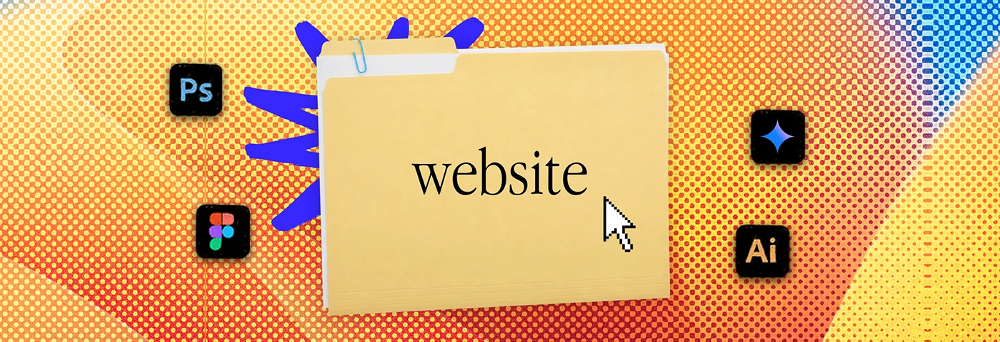

# Halftone gradient banner with a folder and app icons

**Discipline:** print-social ·  · **Design style:** Retro & Pixel
**Tags:** banner, halftone, folder-metaphor, desktop-ui, warm-gradient, blue-scribble, serif-label

## What it is
A wide banner with an orange to red to blue halftone dot texture. A manila folder labelled 'website' in serif sits centre with a pixel cursor, a blue scribble burst behind and app icons around.

## What it means
Nostalgic desktop meets modern zine; it says 'a folder of services' in a fun way.

## Techniques
- Use a desktop metaphor (folder, cursor, app icons) to visualise a service category.
- Apply coarse halftone over a gradient for tactile print grit.
- Add a loose hand-drawn scribble to soften digital objects.
- Label with an elegant serif to contrast with the icons.

## Best for
- Service menu banners and channel headers
- Creative freelancers and agencies
- Slide dividers

## Vocabulary
- **Halftone dots** — A dot screen creating tone or texture.
- **Desktop metaphor** — Using folders and cursors as visual language.
- **Scribble accent** — A hand-drawn burst to add energy.
- **Channel banner** — A wide header for a social profile or channel.
