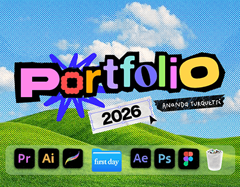

# Square-cropped ransom-note portfolio cover on halftone sky

**Discipline:** print-social ·  · **Design style:** Retro & Pixel
**Tags:** portfolio, thumbnail, halftone, ransom-lettering, sky, dock, project-cover

## What it is
A tighter crop of the multicolour 'Portfolio 2026' cover with the name tape, a blue scribble and the icon dock, formatted as a project thumbnail.

## What it means
Reads at small size: colourful letters and a big sky give instant recognition.

## Techniques
- Recompose a hero cover for a thumbnail by enlarging the title.
- Keep the strongest colour contrast at the centre.
- Retain a dock strip as a base line.
- Use halftone dots to keep the sky textured at any scale.

## Best for
- Behance and Dribbble thumbnails
- Social previews of portfolio decks
- Cover images for case study series

## Vocabulary
- **Thumbnail recompose** — Re-cropping a design for small display.
- **Focal title** — A central word that carries the design.
- **Halftone sky** — A sky rendered in dots.
- **Dock base** — A row of icons anchoring the bottom.
