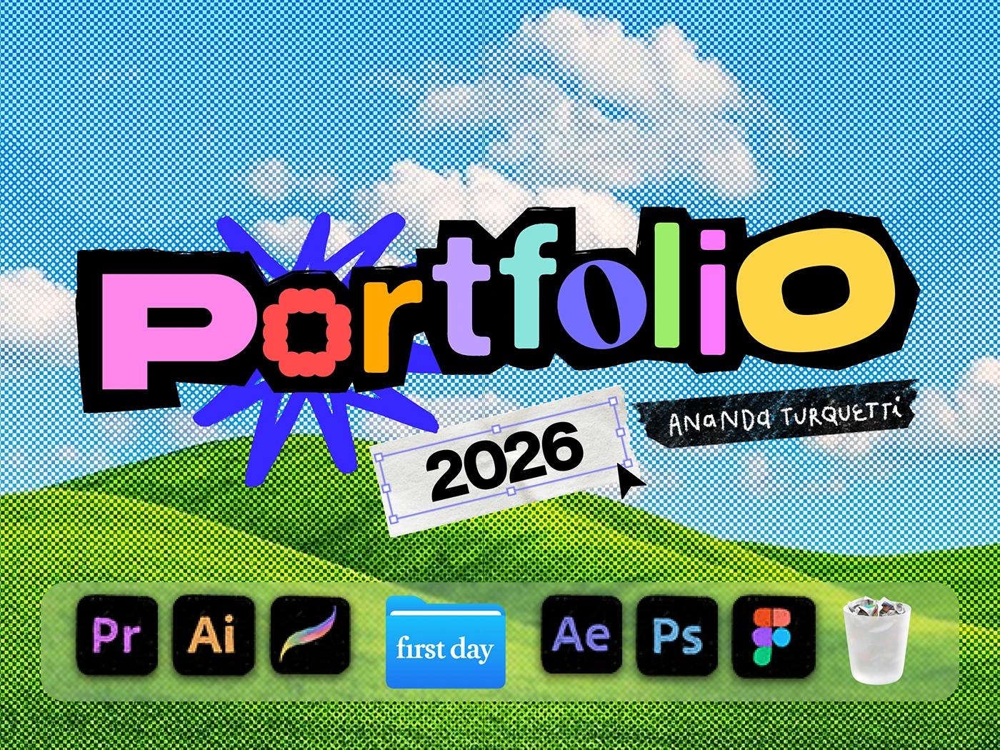

# Portfolio cover with ransom-note letters over halftone hills and a dock of app icons

**Discipline:** print-social ·  · **Design style:** Retro & Pixel
**Tags:** portfolio, cover, halftone, ransom-lettering, sky, hills, dock, nostalgia, colourful

## What it is
A cover in blue-and-white halftone sky and green rolling hills reminiscent of an old desktop wallpaper. 'Portfolio' is spelled in mismatched multicolour letters cut out with black torn edges, with a blue scribble burst, a selected text box '2026', a name tape strip, and a macOS-style dock of creative app icons and a trash can at the bottom.

## What it means
Joyful and nostalgic; combining desktop culture and cut-and-paste zine style feels personal and fun.

## Techniques
- Mix each letter in a different colour and face, with a black torn-paper backing.
- Use a halftoned classic wallpaper landscape as the backdrop.
- Include UI elements (selection box, cursor, dock) as illustration.
- Label with tape strips in handwritten type.

## Best for
- Creative portfolio and CV covers
- Designer self-promotion
- Youthful, nostalgic brand voices

## Vocabulary
- **Ransom-note type** — Letters in mixed styles and colours like a cut-out note.
- **Wallpaper nostalgia** — Referencing classic desktop backgrounds.
- **Dock strip** — A row of app icons like a computer dock.
- **Selection box** — A UI handle box drawn around an object as decoration.
