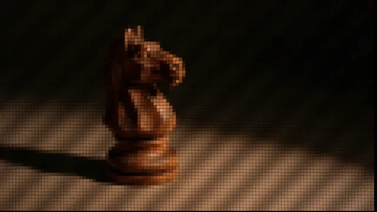

# Wooden chess knight pixelated into a mosaic grid, lit by slatted light and shadow on a dark board

**Discipline:** print-social · **Design type:** Photographic image
**Tags:** photography, chess, pixelated, mosaic, dark, warm, stripes, concept

## What it is
A dark low-key photo of a wooden chess knight on a surface crossed by diagonal light stripes and a long shadow, with a fine square pixel mosaic laid over the whole picture.

## What it means
Strategic and moody; the pixel grid makes an analogue object feel digital.

## Techniques
- Overlay a fine square mosaic on a photo.
- Light with slatted stripes.
- Keep the subject warm against black.
- Cast a long shadow.

## Best for
- Strategy and tech brand imagery
- Pixel-effect photography
- Dark moody backgrounds

## Vocabulary
- **Pixel mosaic** — A fine grid of squares over an image.
- **Slatted light** — Light passing through blinds forming stripes.
- **Low-key photo** — A predominantly dark image.
- **Object metaphor** — An object standing for an idea like strategy.
