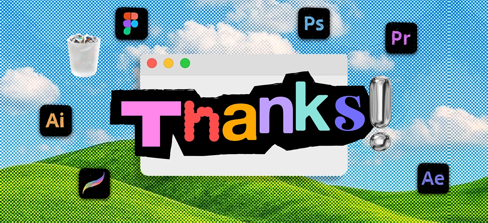

# Thanks slide with ransom letters, chrome exclamation mark and app window on halftone hills

**Discipline:** print-social ·  · **Design style:** Retro & Pixel
**Tags:** closing-slide, halftone, ransom-lettering, chrome, window, icons, hills, nostalgia

## What it is
A halftoned blue sky and green hills backdrop with a grey app window carrying a black torn-paper title 'Thanks' in mismatched colourful letters, followed by a silver chrome exclamation mark, surrounded by Figma, Photoshop, Premiere, Illustrator, Procreate and After Effects icons and a translucent trash can.

## What it means
Cheerful and nostalgic; a chrome punctuation mark adds a shiny modern twist.

## Techniques
- Put a torn black shape behind multicolour letters for high contrast.
- Add a glossy chrome 3D object as punctuation.
- Frame the title inside a fake window with traffic-light buttons.
- Scatter tool icons around as skill tags.

## Best for
- Portfolio closing slides
- Playful creative CVs
- Nostalgic desktop-themed decks

## Vocabulary
- **Chrome 3D** — A shiny metallic rendered object.
- **Fake window** — A drawn app window used as a frame.
- **Torn-paper backing** — A ragged dark shape behind text.
- **Icon scatter** — App icons spread around a central element.
