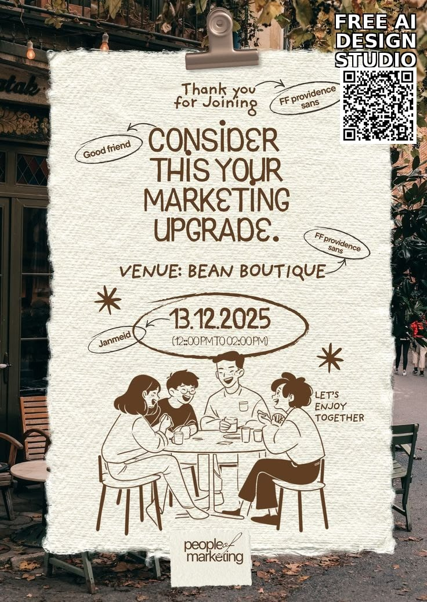

# Hand-Drawn Paper Cafe Event Poster

**Discipline:** print-social ·  · **Design style:** Playful & Illustrated
**Tags:** hand-drawn, paper, cafe, brown, illustration, event, annotations

## What it is
A torn cream paper sheet clipped over a street cafe photo, filled with quirky brown hand-lettered text (Consider this your marketing upgrade), a scribbled date oval, star doodles, font callouts and a line illustration of friends at a table.

## What it means
The handmade, single-colour look feels warm and intimate, like a friendly note, ideal for a casual meetup.

## Techniques
- Torn-edge paper texture on top of a real photo
- Single brown ink colour throughout
- Scribbled ellipse around the date and time
- Annotation arrows and labels as decoration
- Loose line-art illustration of people

## Best for
- Community meetups and cafe events
- Casual social invitations
- Brands wanting a personal, crafted tone

## Vocabulary
- **Torn paper edge** — A ragged border imitating hand-torn paper.
- **Annotation** — Hand-drawn notes and arrows added as visual flavour.
- **One-ink palette** — A design using a single ink colour on a light stock.
