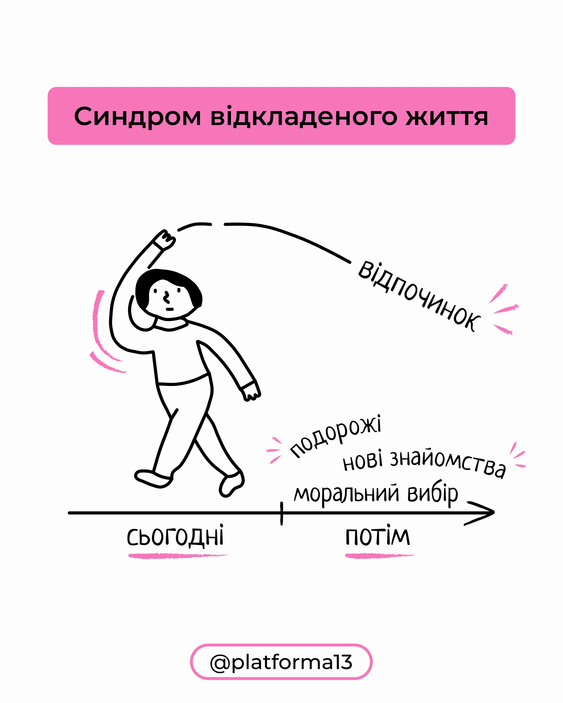

# Psychology explainer: pink title bar, black line-drawn walker and a timeline arrow

**Discipline:** print-social · **Design type:** Social educational post
**Tags:** psychology, doodle, line-art, pink, white, timeline, handwritten, ukrainian

## What it is
A white post with a pink rounded title bar, a black outline figure stretching an arm toward a dashed arc labelled 'rest', a timeline arrow split 'today' and 'later' with words about travel and choices, and pink crayon dashes and underlines. A pink outlined pill holds the handle.

## What it means
Light, human and clear; hand-drawn diagrams make a heavy idea approachable.

## Techniques
- Illustrate a concept with a single line figure and a timeline.
- Use pink crayon accents for emphasis.
- Set labels in a handwritten face.
- Keep the layout airy with a title bar and handle pill.

## Best for
- Psychology and self-help explainers
- Diagram-led posts
- Hand-drawn minimal carousels

## Vocabulary
- **Line figure** — A person drawn in a single outline.
- **Timeline arrow** — An axis showing before and after.
- **Crayon accent** — Rough coloured strokes for emphasis.
- **Handle pill** — An outlined capsule with the account name.
