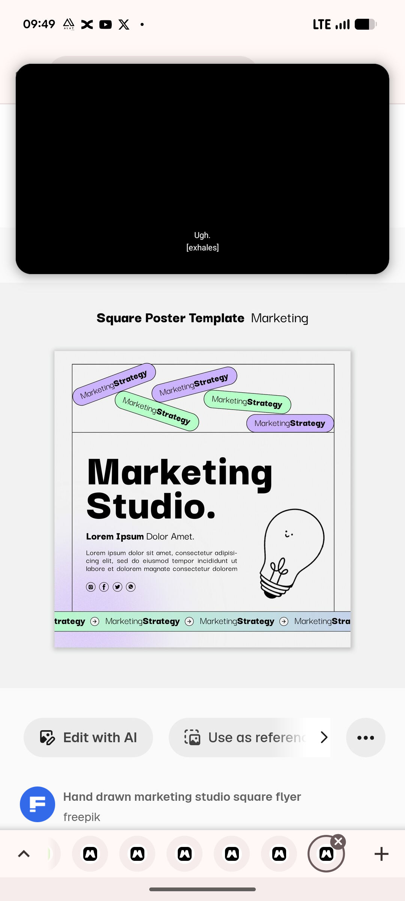

# Hand-Drawn Marketing Studio Square Flyer

**Discipline:** print-social · **Design type:** Product flyer
**Tags:** flyer, marketing, hand-drawn, lilac, mint, pills, lightbulb, square

## What it is
A full view of a square flyer with a black ruled frame, five tilted lilac and mint MarketingStrategy pills across the top, a heavy 'Marketing Studio.' headline, a bold-plus-light subhead, small copy and social icons, a smiling line-art lightbulb and a ticker strip at the base on a lilac wash.

## What it means
Simple black outlines, pastel pills and a doodle keep a business flyer friendly and modern.

## Techniques
- Ruled frame dividing the layout into zones
- Tilted pastel pills as sticker decoration
- Heavy headline with a bold-and-light subhead pair
- Doodle bulb with a face as a mascot
- Ticker strip closing the flyer

## Best for
- Studio and agency flyers
- Hand-drawn style templates
- Pastel accent designs

## Vocabulary
- **Ruled frame** — Thin black lines that divide a layout into zones.
- **Bold-light pairing** — Two weights of the same family within one line.
- **Doodle mascot** — A simple drawing used as a friendly character.
