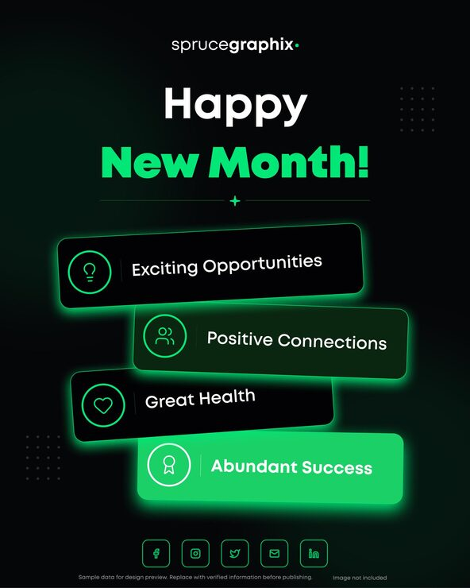

# 'Happy New Month!' post with tilted stacked neon-green wish bars

**Discipline:** print-social · **Design type:** Social promo post · **Design style:** Dark & Neon
**Tags:** new-month, motivational, dark, neon-green, glow, greeting

## What it is
A portrait black post with a 'sprucegraphix' logo, white 'Happy' and green 'New Month!', and four slightly tilted rounded bars with green glowing outlines, each with a line icon (bulb, people, heart, award) and a wish (Exciting Opportunities, Positive Connections, Great Health, Abundant Success), the last filled solid green.

## What it means
Upbeat and modern; stacked glowing tags feel like notifications of good things coming.

## Techniques
- Stack tilted bars like a pile of cards.
- Fill the last item solid as a climax.
- Pair each wish with a simple line icon.
- Glow outlines in the accent colour.

## Best for
- Greeting posts
- Agency social content
- Motivational messages

## Vocabulary
- **Stacked cards** — Overlapping offset panels suggesting a pile.
- **Neon outline** — A glowing coloured stroke.
