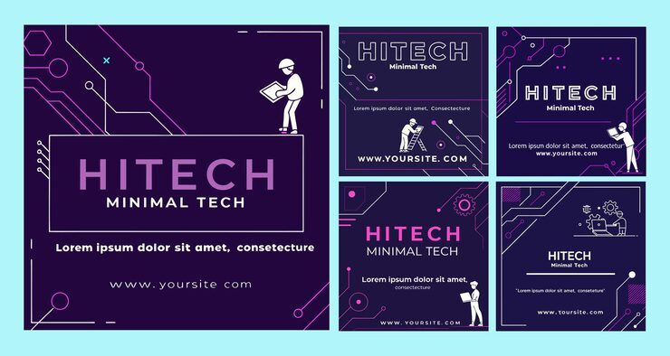

# 'HITECH Minimal Tech' Instagram pack in deep purple with pink neon circuit-line borders and worker figures

**Discipline:** print-social · **Design type:** Social template pack · **Design style:** Dark & Neon
**Tags:** tech, hitech, purple, pink, circuit-lines, instagram

## What it is
Five deep-purple square posts framed by thin pink and cyan neon circuit-line borders with dot nodes, bold split-colour 'HITECH' headlines, small white line-art figures of workers with laptops and gears, and 'Minimal Tech' subtitles with a website line.

## What it means
Sharp and techy; glowing circuit borders on deep purple make a generic tech template feel like a specialised electronics brand.

## Techniques
- Frame a post with thin neon circuit-line borders.
- Split a headline word across two accent colours.
- Add small line-art worker figures for a human touch on a tech theme.

## Best for
- Tech and electronics social content
- Startup branding
- Neon-accented templates

## Vocabulary
- **Circuit-line border** — A decorative frame styled after electronic pathways.
- **Split-colour headline** — A single word coloured in two different hues.
