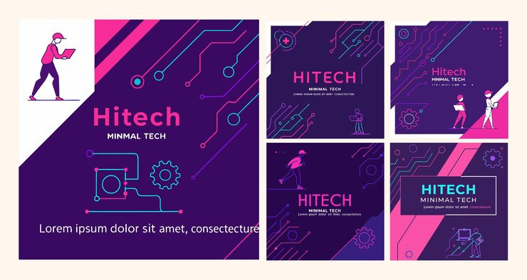

# 'Hitech Minimal Tech' pack in deep purple with pink-cyan circuit-line icons and diagonal split covers

**Discipline:** print-social · **Design type:** Social template pack · **Design style:** Dark & Neon
**Tags:** tech, hitech, purple, pink, circuit-lines, instagram

## What it is
Five deep-purple square posts split diagonally with white corners, glowing pink-and-cyan circuit-line paths and node dots, small flat character illustrations of people with laptops, gear and settings line icons, and 'Hitech Minimal Tech' headlines.

## What it means
Sharp and techy; the glowing circuit paths turn a plain diagonal split into a distinctly electronic visual signature.

## Techniques
- Split a square diagonally between white and a bold colour field.
- Draw glowing circuit-line paths with dot nodes as a tech motif.
- Use small flat character illustrations for a human touch.

## Best for
- Tech and electronics social content
- Startup branding
- Neon-accented templates

## Vocabulary
- **Circuit-line motif** — A decorative pattern resembling electronic pathways.
- **Diagonal split cover** — A layout divided by an angled line into two fields.
