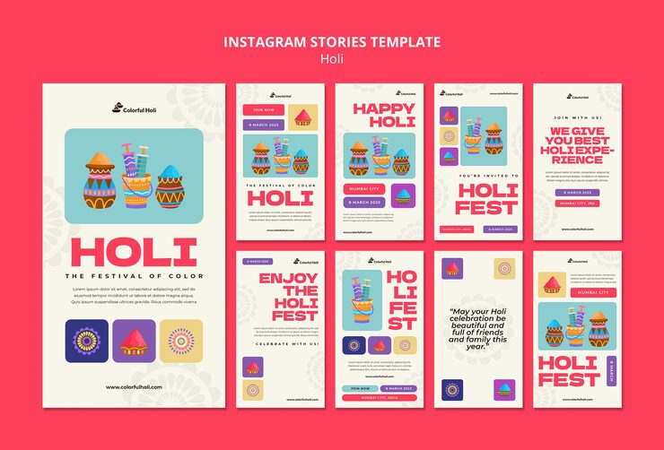

# 'Holi, The Festival of Color' story set in coral and cream with illustrated powder pots and mandala patterns

**Discipline:** print-social · **Design type:** Story set · **Design style:** Playful & Illustrated
**Tags:** holi, festival, coral, cream, powder-pots, story

## What it is
Ten vertical story cards in coral and cream, each with a flat illustration of stacked colourful powder pots (gulal), faint mandala flower patterns, small colour-swatch squares, and headlines ('Holi Fest', 'Happy Holi', 'Enjoy the Holi Fest') with event details.

## What it means
Vibrant and cultural; illustrated powder pots and mandala patterns capture Holi's colour and joy without needing photography.

## Techniques
- Illustrate the festival's signature object (powder pots) as the hero motif.
- Use faint mandala patterns as a culturally resonant background texture.
- Show small colour swatches as a literal palette preview.

## Best for
- Holi festival marketing
- Cultural celebration campaigns
- Illustrated event branding

## Vocabulary
- **Gulal** — The coloured powder traditionally used during Holi.
- **Mandala pattern** — A concentric, symmetrical geometric pattern of spiritual origin.
