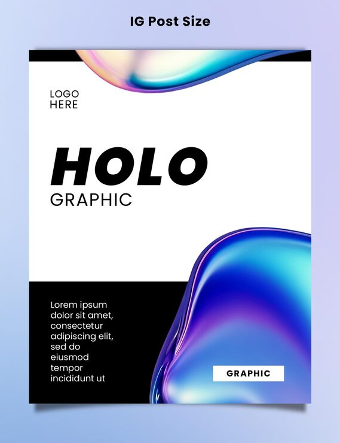

# 'Holo Graphic' poster with black text bands and a large holographic blob wrapping two corners

**Discipline:** print-social · **Design type:** Social ad · **Design style:** Gradient & Aurora
**Tags:** holographic, white, black-bands, blob, bold-type, instagram

## What it is
A white square post with a black band across the top curved by a holographic wave, bold black 'HOLO GRAPHIC' title, a black band of body copy at bottom, and a large glossy holographic blob wrapping from bottom-right up through the centre.

## What it means
Bold and current; the wraparound holographic shape gives a stark black-and-white layout an on-trend, futuristic edge.

## Techniques
- Curve a solid colour band with a holographic wave edge.
- Let one large holographic shape span from corner to corner.
- Contrast the shiny holographic area against flat black-and-white blocks.

## Best for
- Design trend showcases
- Holographic branding
- Bold black-and-white layouts

## Vocabulary
- **Wave edge** — A curved, flowing line used to break up a straight band.
- **Corner-to-corner shape** — A large graphic element spanning diagonally across a layout.
