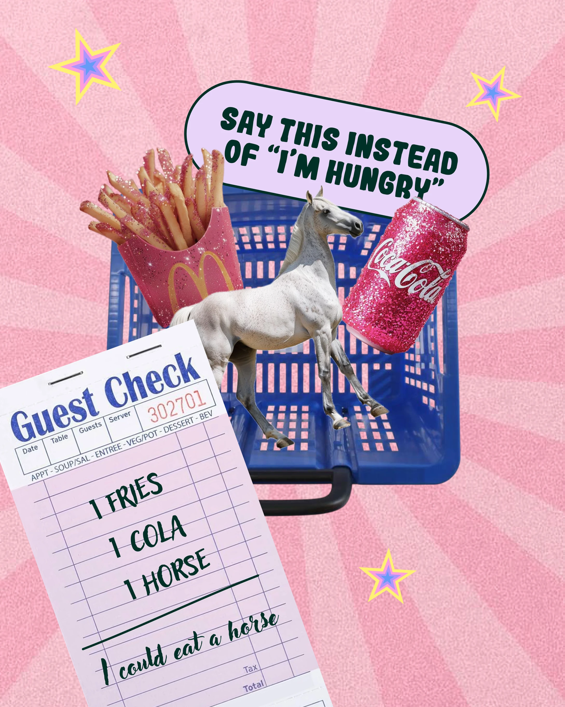

# Idiom post with glitter fries, cola can, horse and guest check

**Discipline:** print-social ·  · **Design style:** Photographic & Cinematic
**Tags:** idiom, collage, pink, glitter, stars, sunburst, cutout, bubble-type, humour

## What it is
A pink sunburst 4:5 post with a lavender pill caption 'Say this instead of I'm hungry'. Cut-outs of glittery fries, a glitter cola can, a white horse on a blue shopping basket and a tilted restaurant guest check reading '1 horse' illustrate the idiom, with pastel stars around.

## What it means
Absurd, glossy and shareable; taking the idiom literally makes it memorable and funny.

## Techniques
- Illustrate an idiom literally with unexpected cut-outs.
- Use a real paper form (guest check) with handwritten script as a punchline.
- Coat everyday objects with glitter for a maximalist Y2K feel.
- Layer a pale sunburst background under the objects for energy.

## Best for
- Language-learning and edutainment posts
- Humour-led social accounts
- Campaigns wanting surreal collage

## Vocabulary
- **Literal illustration** — Depicting a phrase word-for-word.
- **Sunburst background** — Radiating stripes behind the subject.
- **Found-paper element** — A real document reused as a graphic.
- **Glitter texture** — Sparkly surface treatment on objects.
