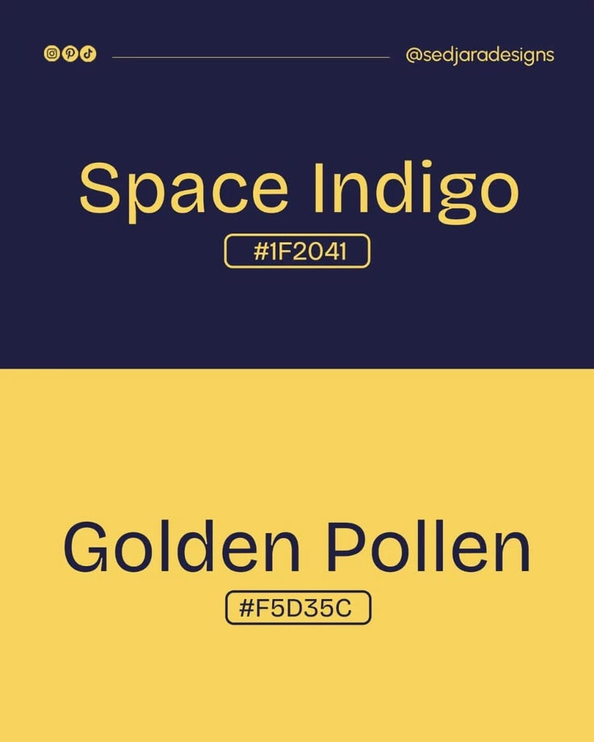

# Space Indigo and Golden Pollen Colour Post

**Discipline:** print-social · **Design type:** Social educational post
**Tags:** colour, indigo, yellow, split, hex, minimal, palette

## What it is
A portrait post split into a deep indigo upper half with yellow 'Space Indigo #1F2041' and a golden yellow lower half with indigo 'Golden Pollen #F5D35C', hex codes in outlined pills and a handle strip at the top.

## What it means
Each colour is the other's text colour, so the pairing proves itself, and the names add poetry.

## Techniques
- Swap colours between halves
- Evocative colour names
- Outlined hex pill
- Handle header with icons
- Only two colours

## Best for
- Colour palette posts
- Minimal two-colour layouts
- Design inspiration accounts

## Vocabulary
- **Colour name** — A descriptive name given to a colour.
- **Hex pill** — An outlined label holding a colour code.
- **Inverted pair** — Two colours used as each other's foreground and background.
