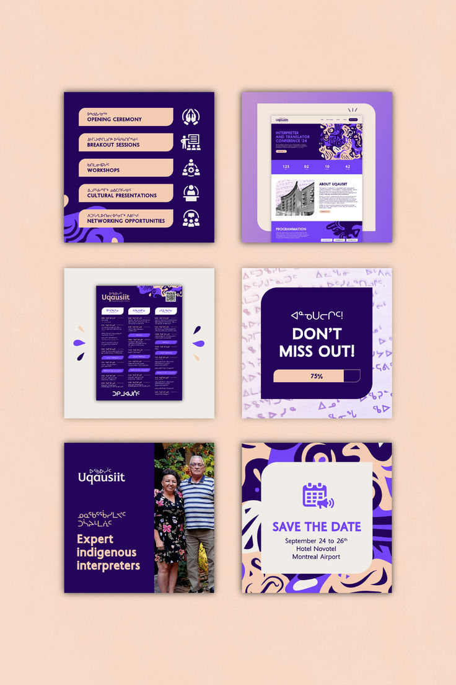

# Indigo, peach and violet conference kit with organic blob patterns and pill agenda cards

**Discipline:** print-social ·  · **Design style:** Gradient & Aurora
**Tags:** conference, indigo, peach, violet, blob-pattern, agenda, pills, icons

## What it is
Six square assets on peach: an agenda list of peach pills with white icons on indigo, a website preview on a lilac field, a programme leaflet, a 'Don't miss out!' progress-bar post over a syllabics pattern, a speaker-photo split, and a save-the-date over a peach-violet blob pattern.

## What it means
Warm and respectful; organic patterns and syllabics give cultural identity.

## Techniques
- Use organic blob patterns as brand texture.
- Agenda items as peach pills with icons.
- Use a progress bar for countdown.
- Show website, print and social together.

## Best for
- Conference and cultural events
- Multi-format event kits
- Indigo and peach palettes

## Vocabulary
- **Blob pattern** — A pattern of flowing organic shapes.
- **Agenda pill** — A capsule with an event item.
- **Progress countdown** — A bar showing time or seats left.
- **Event kit** — A set of assets for one event.
