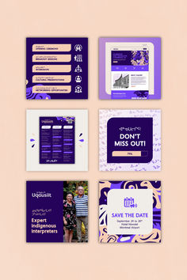

# Small preview of the indigo and peach conference kit

**Discipline:** print-social · **Design type:** Social template pack
**Tags:** conference, indigo, peach, thumbnail, blob-pattern, pills, kit, preview

## What it is
A tiny pin-size version of the six-tile conference kit on peach, showing the agenda, website, leaflet, countdown, speaker and save-the-date tiles.

## What it means
Reads clearly even small thanks to strong indigo blocks.

## Techniques
- Use strong dark tiles that survive downsizing.
- Alternate dark and light tiles.
- Keep a peach background.
- Grid tiles evenly.

## Best for
- Pinterest and portfolio thumbnails
- Kit overviews
- Small previews

## Vocabulary
- **Thumbnail preview** — A small image summarising a set.
- **Tile alternation** — Dark and light tiles interleaved.
- **Overview grid** — Several assets shown together.
- **Contrast survival** — Design that stays legible at small size.
