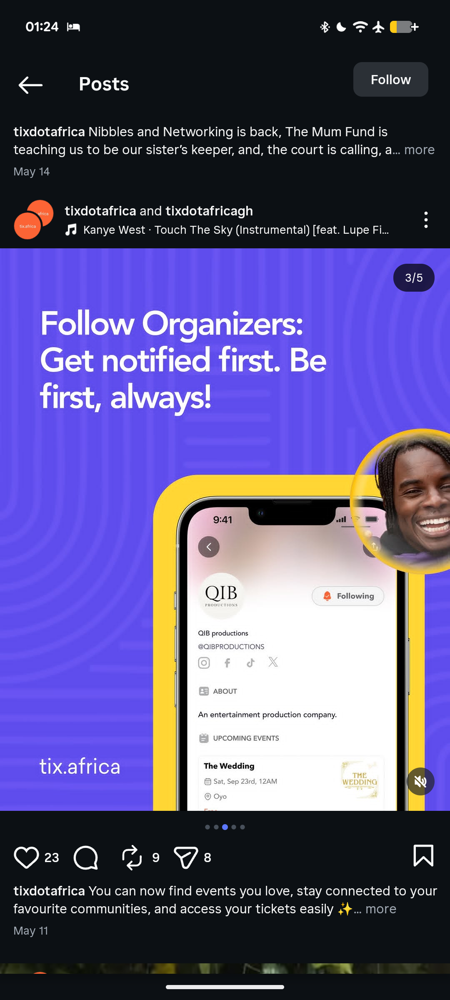

# Follow Organizers Slide with Profile Screen

**Discipline:** print-social ·  · **Design style:** Photographic & Cinematic
**Tags:** carousel, indigo, yellow, phone-mockup, profile, follow, product-feature

## What it is
The next indigo slide with the headline 'Follow Organizers: Get notified first. Be first, always!', a phone in a yellow frame showing an organizer profile with a Following pill, social icons and upcoming event, and a large smiling portrait in a yellow-ringed circle cropped at the top right.

## What it means
A repeated layout with a new screen and a new face makes a series feel consistent and human.

## Techniques
- Same frame and headline system as the previous slide
- Portrait circle cropped by the canvas edge
- Profile screen shown in a phone
- White headline with punchy sentences
- Repeated site name at the base

## Best for
- Multi-slide feature announcements
- Product marketing carousels
- Consistent slide systems

## Vocabulary
- **Slide system** — A repeated layout across the slides of a carousel.
- **Cropped portrait** — A portrait cut by the edge of the frame.
- **Following state** — A button state showing that the user follows an account.
