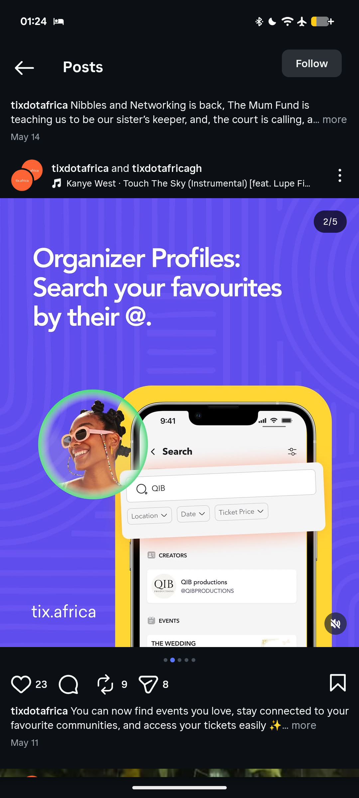

# Organizer Profiles Slide with Yellow Phone Frame

**Discipline:** print-social · **Design type:** Social carousel
**Tags:** carousel, indigo, yellow, phone-mockup, avatar-circle, search, product-feature

## What it is
An indigo carousel slide with a large white headline 'Organizer Profiles: Search your favourites by their @.', a phone inside a rounded yellow frame showing a search screen with a floating search card, and a round photo of a smiling woman with a green ring overlapping the phone.

## What it means
Yellow on indigo is a strong pairing, and the overlapping avatar bubble puts a person next to the feature.

## Techniques
- Phone set inside a rounded coloured frame
- Floating search card lifted out of the screen
- Round photo with a coloured ring overlapping the device
- Big white headline top left
- Site name anchored at the bottom left

## Best for
- Feature explainer carousels
- App marketing on social
- Bold two-colour slides

## Vocabulary
- **Device frame** — A coloured shape framing a phone mockup.
- **Floating UI** — An interface element lifted off the screen.
- **Avatar bubble** — A round photo with a ring placed over the layout.
