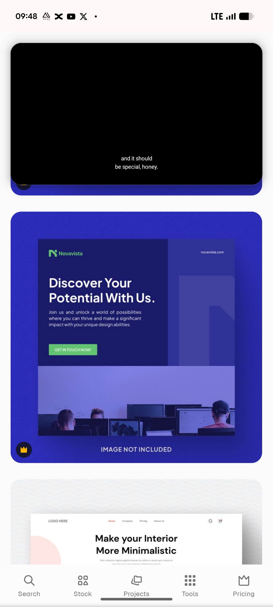

# Indigo Discover Your Potential Banner

**Discipline:** print-social · **Design type:** Social banner
**Tags:** banner, indigo, green-cta, duotone-photo, logo, business, template

## What it is
An indigo banner template with a dark navy panel holding a green logo, the headline 'Discover Your Potential With Us.', a paragraph and a green GET IN TOUCH NOW button beside a faint large letter shape, over a violet-tinted photo strip of people working at computers.

## What it means
A duotone photo in the brand violet keeps imagery on-palette, and the green button is the sole contrast.

## Techniques
- Duotone photo tinted to the brand colour
- Solid green button on indigo
- Oversized ghost logo shape in the panel
- Panel and photo stacked as two zones
- Light headline with a smaller paragraph

## Best for
- Web and social banner templates
- Recruitment and business promos
- Indigo and green brand systems

## Vocabulary
- **Duotone photo** — A photo tinted in one hue range.
- **Ghost logo** — A large faint logo shape used as a background.
- **Two-zone banner** — A banner divided into a text zone and an image zone.
