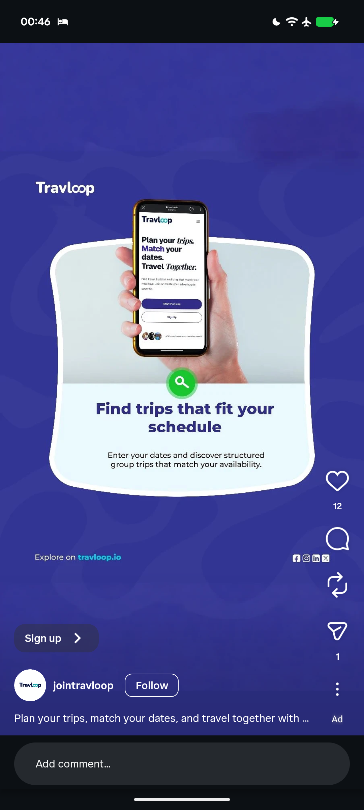

# Trip Planner Ad with Scalloped Card

**Discipline:** print-social · **Design type:** Social ad
**Tags:** ad, indigo, travel, phone-in-hand, scalloped-card, serif-italic, green-search

## What it is
An indigo ad with faint swirl shapes, a white wordmark at the left, a wavy-edged white card holding a hand-held phone photo of a mobile site, a green magnifier button on its edge and the headline 'Find trips that fit your schedule' with a short line, plus a site line and social icons at the base.

## What it means
A soft wobbly card frames the product photo in a friendly way, and a green button gives the one moment of contrast.

## Techniques
- Wavy-edged card like a soft frame
- Hand-held phone as the hero image
- Green magnifier button overlapping the edge
- Two-tone headline in dark indigo
- Faint swirl background

## Best for
- Travel and community app ads
- Feature announcement ads
- Indigo and green brand systems

## Vocabulary
- **Scalloped card** — A card with soft wavy edges.
- **Edge button** — A round button placed across a card's border.
- **Swirl background** — Faint flowing shapes used as texture.
