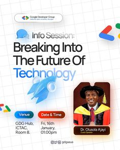

# Grid-paper info session flyer with a cutout speaker, 3D rocket and venue and date pills

**Discipline:** print-social · **Design type:** Event flyer
**Tags:** event, info-session, grid-paper, blue, rocket, pills, google-colours, speaker

## What it is
A white grid-paper flyer with a Google Developer Group logo pill, 'Info Session: Breaking Into The Future Of Technology' with a blue gradient last words, a glossy 3D blue rocket, a speaker cutout in graduation robes with a name card, blue and pink pills for venue and date and multi-colour chevrons at the edges.

## What it means
Bright and academic; the rocket signals launching a tech career.

## Techniques
- Use grid paper as the background.
- Colour the last words in a gradient.
- Add a glossy 3D object.
- Turn logistics into coloured pills.

## Best for
- Tech community info sessions
- Developer group flyers
- Speaker-led event posts

## Vocabulary
- **Grid-paper ground** — A squared notebook background.
- **3D rocket** — A glossy rendered rocket icon.
- **Speaker cutout** — A person without their background.
- **Info pill** — A capsule with venue or date.
