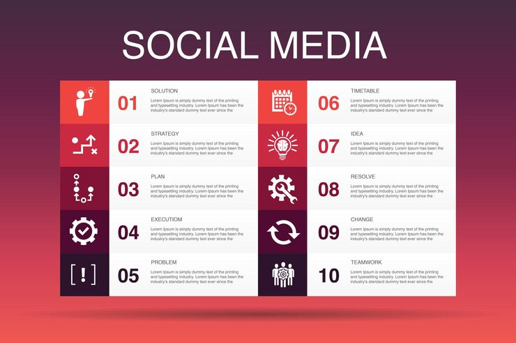

# Ten-item numbered social media checklist on red gradient

**Discipline:** print-social · **Design type:** Product infographic set · **Design style:** Gradient & Aurora
**Tags:** infographic, numbered list, gradient, red, icons, checklist

## What it is
A ten-item two-column list infographic on a dark red-to-purple gradient, each row pairing a large numeral, a simple icon and a short label.

## What it means
A strict two-column numbered grid makes a ten-step process feel finite and organized rather than overwhelming, letting a reader mentally 'count down' through it.

## Techniques
- split a long numbered list into two columns to keep the overall shape compact
- pair each numeral with a small flat icon for faster visual scanning than text alone
- use a dark gradient background so white list cards read with strong contrast

## Best for
- strategy/process explainer graphics
- social media agency checklists
- step-by-step educational infographics

## Vocabulary
- **numbered list infographic** — an infographic format organizing content as a sequence of numbered items, often used for steps or tips
