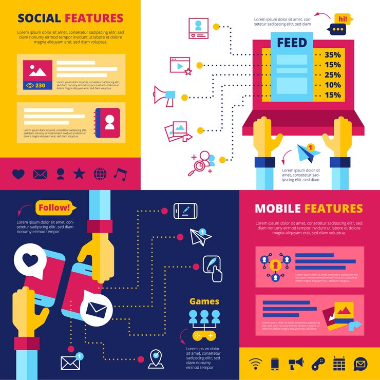

# Four-quadrant color-block social features infographic

**Discipline:** print-social · **Design type:** Product infographic set · **Design style:** Retro & Pixel
**Tags:** infographic, quadrant, color block, flat illustration, yellow magenta navy, features

## What it is
A four-quadrant infographic (yellow, magenta, navy, pink) each dedicated to a different feature theme (social features, feed, mobile features, follow/games) with flat illustrated hands, devices and connector dotted lines.

## What it means
Dividing a feature list into four solid-color quadrants lets a dense feature set be organized spatially by category, so a viewer can jump straight to the section they need.

## Techniques
- divide a page into hard-edged solid-color quadrants, one per topic
- illustrate a raised hand or arm reaching into the frame to add human energy to flat icons
- connect related icons with dotted paths within each quadrant to show relationships

## Best for
- app feature overview graphics
- social platform explainer infographics
- bold flat-illustration marketing sets

## Vocabulary
- **color block** — a design technique dividing a layout into solid blocks of contrasting flat color
