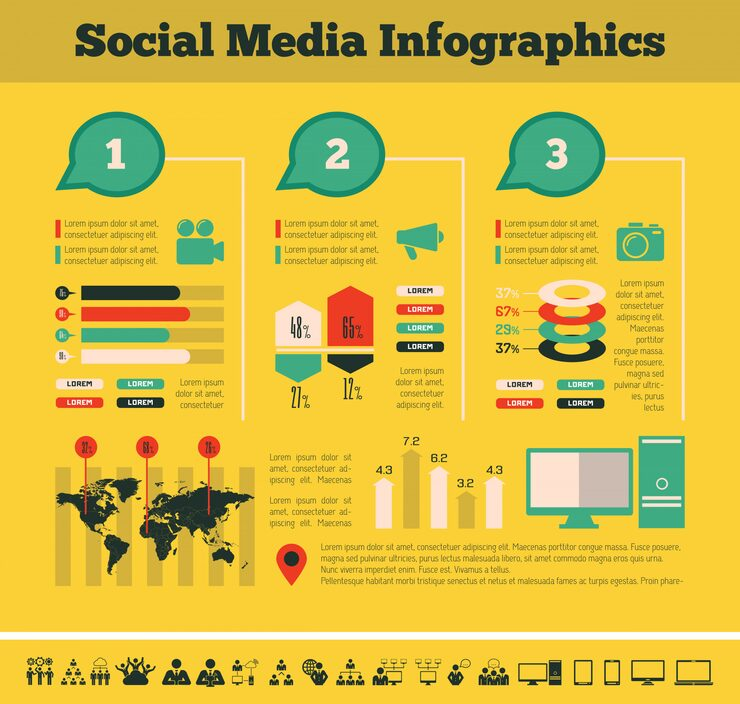

# Yellow retro three-column social media infographic

**Discipline:** print-social · **Design type:** Product infographic set · **Design style:** Retro & Pixel
**Tags:** infographic, retro, yellow, teal, three column, icons

## What it is
A yellow infographic split into three numbered speech-bubble columns, each combining a flat retro icon, colored progress/percentage bars, and a world map with a bar chart beneath.

## What it means
Retro flat icons and a warm yellow/teal palette give data a friendly, approachable tone that softens what could otherwise be a dry statistics dump.

## Techniques
- organize a wide infographic into three clearly numbered vertical sections
- use speech-bubble shapes as section headers to imply 'talking points'
- apply a consistent retro flat-icon style across otherwise varied chart types for cohesion

## Best for
- social media marketing reports
- retro-branded content marketing
- teal/yellow brand infographics

## Vocabulary
- **progress bar** — a horizontal bar visually representing a percentage or completion value
