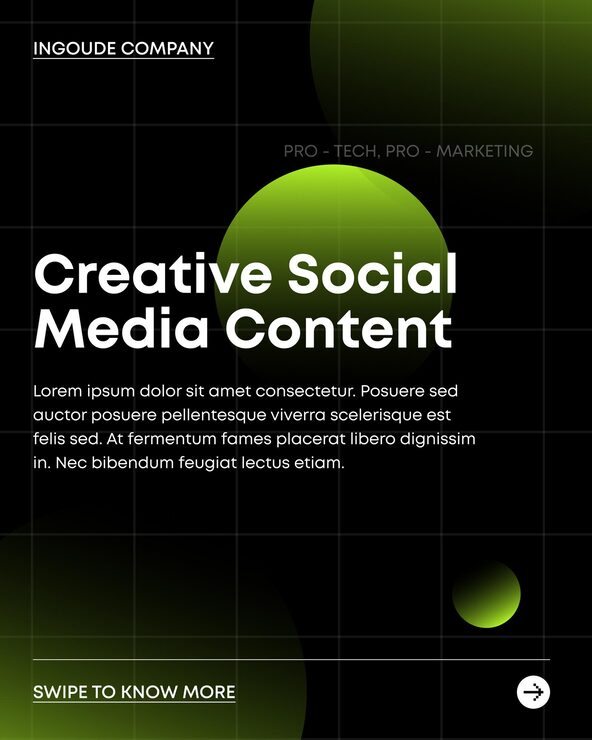

# 'Creative Social Media Content' post with glowing green orbs on a black grid and a swipe arrow

**Discipline:** print-social · **Design type:** Social promo post · **Design style:** Dark & Neon
**Tags:** agency, black, green, glowing-orb, grid, swipe

## What it is
A black portrait post with a faint grid, two glowing lime-green gradient orbs of different sizes, an underlined 'INGOUDE COMPANY' header, 'PRO - TECH, PRO - MARKETING' tag, a bold white headline, body copy, and a 'SWIPE TO KNOW MORE' footer with an arrow icon.

## What it means
Sleek and modern; glowing orbs against a grid feel techy without needing any literal icons or photography.

## Techniques
- Use varied-size glowing orbs as the sole visual interest.
- Underline a company name for a simple wordmark treatment.
- Signal a carousel with an explicit 'swipe' footer and arrow.

## Best for
- Agency and tech content
- Carousel opener posts
- Minimal dark-mode branding

## Vocabulary
- **Glowing orb** — A soft-edged circle of light used as an abstract accent.
- **Swipe cue** — A visual or textual hint that more content follows in a carousel.
