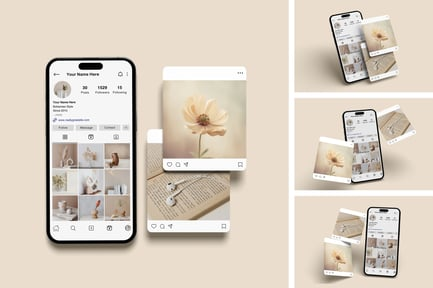

# Neutral Instagram feed mockup with floral flat-lay

**Discipline:** print-social · **Design type:** Feed mockup · **Design style:** Warm & Organic
**Tags:** instagram, feed mockup, flatlay, neutral, beige, florals, mockup

## What it is
A phone-screen Instagram profile mockup shown beside repeated flat-lay preview panels, all styled in a beige/cream palette with a floral macro photo, a notebook and earbuds.

## What it means
The single warm background color unifies every panel into one cohesive grid, so the eye reads it as a considered aesthetic rather than a jumble of separate images.

## Techniques
- restrict all imagery to one warm neutral palette so the grid reads as curated
- pair a device mockup with cropped detail shots to sell the feel of the whole feed at once
- repeat the same composition at shrinking scale to show consistency across a series

## Best for
- personal brand or lifestyle Instagram grids
- mockup packs for selling design templates
- portfolio presentation of a social content system

## Vocabulary
- **flat-lay** — a photography style shooting objects from directly overhead on a flat surface
