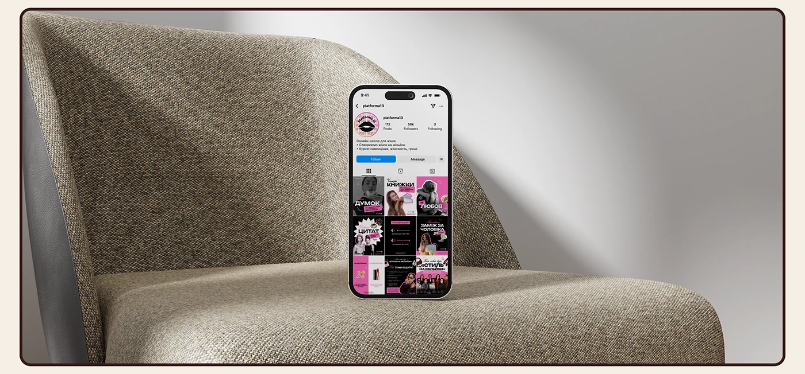

# Pink and black Instagram feed shown on a phone standing on a woven armchair

**Discipline:** print-social ·  · **Design style:** Warm & Organic
**Tags:** instagram, feed-grid, mockup, pink, black, textile, chair, cream-frame

## What it is
A wide image with a small phone standing upright on the seat of a woven grey armchair in soft light, its screen showing a profile grid of black and pink posts. A thin brown rounded border frames it on cream.

## What it means
Quiet and stylish; the big neutral textile makes the tiny colourful feed stand out.

## Techniques
- Set the phone small in a large neutral scene so the colour feed pops.
- Use textured fabric and soft light for a premium look.
- Show the whole grid on the profile page rather than one post.
- Frame with a thin rounded border.

## Best for
- Social media design portfolios
- Feed system presentations
- Brand rollouts for creators

## Vocabulary
- **Negative-space mockup** — A tiny device in a large calm scene.
- **Textile backdrop** — A fabric texture used as a background.
- **Profile grid** — The mosaic of posts on a profile.
- **Case-study frame** — A rounded border that crops an image as a tile.
