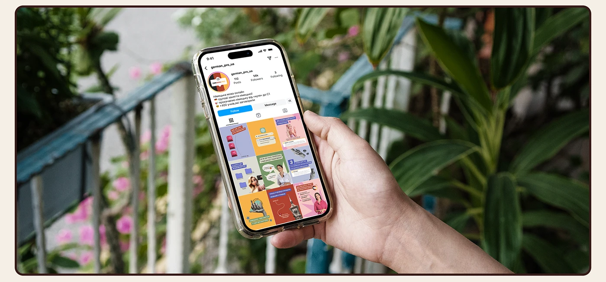

# Language-school Instagram profile on a phone held before tropical foliage

**Discipline:** print-social · **Design type:** Feed mockup
**Tags:** instagram, feed-grid, mockup, plants, cream-frame, multicolour, hand-held, education

## What it is
A rounded brown-outlined image of a hand holding a phone in front of blurred leaves and pink flowers. The screen shows a school profile with a multicolour post grid in blue, orange, pink, green and red.

## What it means
Fresh and friendly; natural greens make the colourful grid feel lively.

## Techniques
- Use out-of-focus plants as a natural backdrop.
- Let the grid's varied colours pop against greens.
- Hold the phone slightly tilted for a candid feel.
- Frame it in a cream border.

## Best for
- Social media portfolio mockups
- Education and lifestyle accounts
- Feed cohesion demos

## Vocabulary
- **Natural bokeh** — Blurred foliage as a backdrop.
- **Colour-varied grid** — A feed with several bright hues held together by layout.
- **Candid mockup** — A device shot that looks casually taken.
- **Cream frame** — A pale border around a photo.
