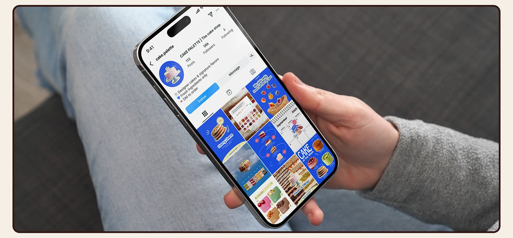

# Instagram profile grid shown on a phone held over denim

**Discipline:** print-social ·  · **Design style:** Warm & Organic
**Tags:** instagram, feed-grid, mockup, blue, bakery, in-hand, cream-frame

## What it is
A photo of a hand holding a phone that shows a bakery's Instagram profile. The feed is a coherent grid of cobalt-blue posts with cakes, a calendar and a fruit basket, framed by a rounded brown border on cream.

## What it means
It sells the whole feed as one identity; seeing it in a real hand makes the brand feel already live.

## Techniques
- Show a social system as a full profile grid so cohesion is judged in context.
- Photograph the phone in a casual lap or hand scene for realism.
- Frame the image with a thin rounded border to make it a case-study tile.
- Let one saturated brand colour dominate every tile in the grid.

## Best for
- Social media design portfolios
- Brand rollouts for food and retail
- Pitching a feed aesthetic to clients

## Vocabulary
- **Feed cohesion** — The consistent look of posts viewed together on a profile.
- **Profile mockup** — A presentation showing a brand's social page on a device.
- **Colour-locked grid** — A grid where posts share one dominant colour.
- **Lifestyle mockup** — A device photographed in an everyday scene.
