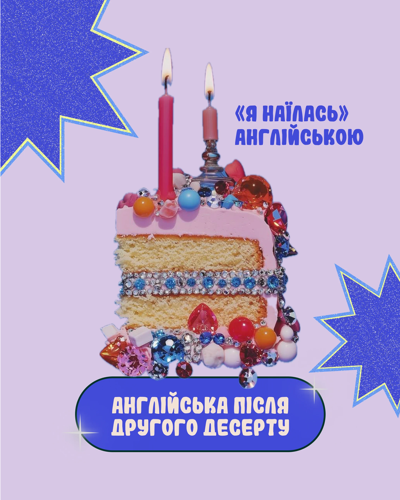

# Lilac post with a rhinestone-covered cake slice, glitter cobalt starbursts and a rounded cobalt caption

**Discipline:** print-social ·  · **Design style:** Photographic & Cinematic
**Tags:** language, cake, jewels, lilac, cobalt, glitter, starburst, cyrillic

## What it is
A lilac portrait with two glitter cobalt starbursts with yellow edges at the corners, a cutout slice of pink-frosted sponge covered in gems and pearls with two lit candles, a blue script-like title at the right and a cobalt pill with cream caps at the bottom with sparkle stars.

## What it means
Glamorous and funny; a jewelled cake makes 'stuffed' English feel like a party.

## Techniques
- Use one lavish cutout as the hero.
- Add glitter starbursts at corners.
- Set a chunky title in cobalt.
- Use a rounded pill for the caption.

## Best for
- Language posts with humour
- Cutout hero posts
- Cobalt and lilac palettes

## Vocabulary
- **Jewelled object** — An item covered in rhinestones.
- **Corner starburst** — A large spiky shape in a corner.
- **Hero cutout** — A single large cut-out object.
- **Sparkle glyph** — A small four-point star.
