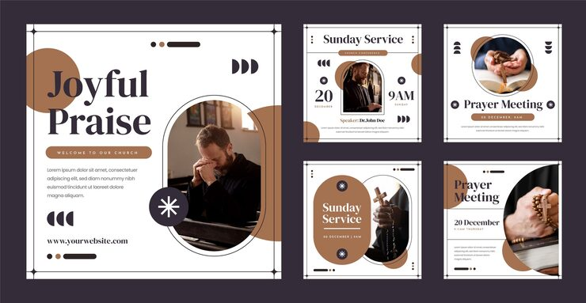

# 'Joyful Praise' church pack with arch-cropped photos, brown circles and line-frame corners

**Discipline:** print-social · **Design type:** Social template pack · **Design style:** Geometric & Bauhaus
**Tags:** church, prayer, brown, arch, serif, instagram

## What it is
Five white posts with thin line frames with cross-hair corners, brown circles and half-circles, arch and circle-cropped photos of people praying and holding rosaries, serif headlines ('Joyful Praise', 'Sunday Service', 'Prayer Meeting'), brown pill labels, a black circle with a white asterisk, and triple half-circle ornaments.

## What it means
Gentle and modern; arches echo church windows while clean framing keeps it contemporary.

## Techniques
- Crop photos in arch shapes as a window reference.
- Draw a thin frame with cross-hair corners.
- Use repeating half-circles as small ornaments.
- Put the welcome in a pill under the title.

## Best for
- Churches
- Prayer events
- Faith community posts

## Vocabulary
- **Arch crop** — A photo masked with a rounded top like a window.
- **Crop marks** — Small corner lines like printer's marks.
