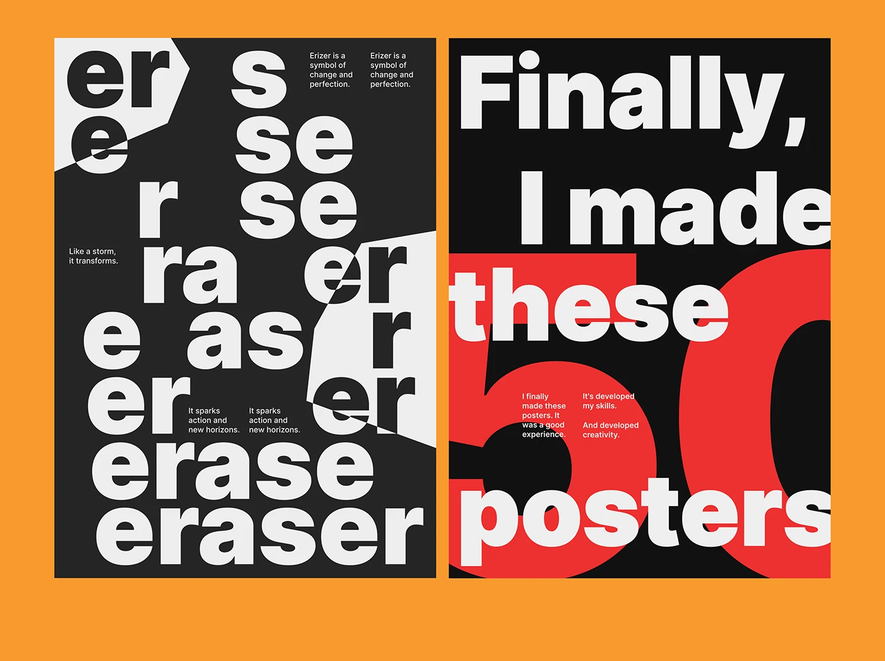

# Two type-only posters: broken repeating word and giant red numeral

**Discipline:** print-social ·  · **Design style:** Minimalist
**Tags:** poster, typography, black-and-white, red, grotesque, repetition, numerals, orange-backdrop

## What it is
Two portrait posters on orange. The left is charcoal with the word 'eraser' repeated and gradually erased or cut, with white angular wedges slicing through. The right is black with 'Finally, I made these 50 posters' in heavy white grotesque over an enormous red '50'.

## What it means
Loud, editorial and confident; type itself is the image.

## Techniques
- Repeat a word and progressively remove letters to visualise its meaning.
- Cut the composition with sharp white wedges that mask letters.
- Overlay huge numerals in a single red behind the text.
- Bleed letters off the edge for scale.
- Contrast tiny body copy with massive display type.

## Best for
- Poster series and typographic experiments
- Event and exhibition graphics
- Bold social announcements

## Vocabulary
- **Type-as-image** — Using letterforms as the main visual.
- **Erasure effect** — Progressively hiding letters to depict removal.
- **Bleeding type** — Letters that extend beyond the canvas edge.
- **Scale contrast** — Mixing tiny and huge text.
