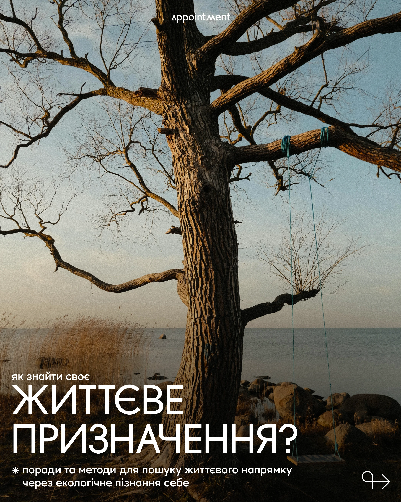

# Golden-hour photo of an old tree with a swing by the sea with giant light caps and small notes

**Discipline:** print-social ·  · **Design style:** Warm & Organic
**Tags:** wellness, photo, tree, swing, white-caps, golden-hour, arrow, cyrillic

## What it is
A portrait photo of a big bare tree with a blue rope swing at the sea in warm dusk light, with a small logo at the top, a small caps line, giant light white 'ЖИТТЄВЕ ПРИЗНАЧЕННЯ?' at the lower left, a two-line asterisk note and a curly arrow at the lower right.

## What it means
Reflective and nostalgic; the empty swing suggests reflection.

## Techniques
- Place big light caps over darker lower area.
- Use a small caps lead-in above.
- Add an asterisk note and arrow.
- Keep the photo natural.

## Best for
- Purpose and meaning content
- Photo-led editorial covers
- Wellness accounts

## Vocabulary
- **Lower-third headline** — A headline placed at the bottom of a photo.
- **Lead-in caps** — A small caps line above a big headline.
- **Swipe arrow** — A curly arrow hinting at the next slide.
- **Golden-hour photo** — A photo taken in warm low sun.
