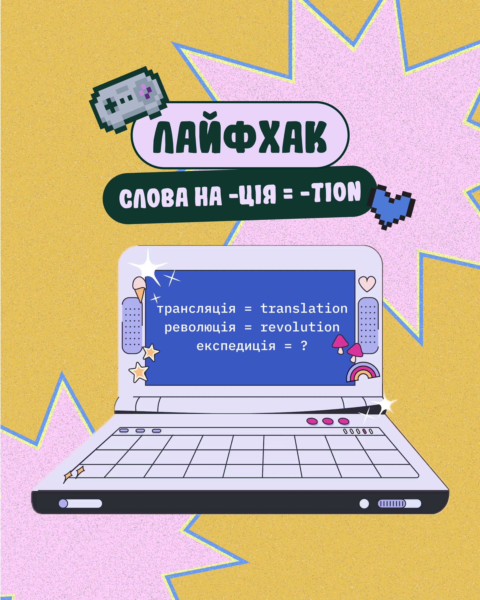

# Mustard 'life hack' post with a retro laptop screen, pill titles, pink starbursts and pixel icons

**Discipline:** print-social · **Design type:** Social educational post
**Tags:** education, language, mustard, pink, starburst, retro-laptop, pixel-art, grain, cyrillic

## What it is
A grainy mustard post with big pink starbursts outlined in blue and yellow, a lavender pill title in fat display letters, a dark green pill subtitle, pixel gamepad and heart, and a lilac retro laptop whose blue screen shows word equivalents in monospace, decorated with sparkles, mushrooms and a rainbow.

## What it means
Playful and nostalgic; the retro laptop makes vocabulary tricks feel like a game.

## Techniques
- Show the lesson on a drawn retro laptop screen.
- Stack pill titles in two colours.
- Use grain and starbursts behind.
- Add pixel icons and sticker doodles.

## Best for
- Language tips
- Retro-tech educational posts
- Grainy sticker-style carousels

## Vocabulary
- **Retro laptop** — A flat illustration of an old computer.
- **Pill title** — A headline inside a rounded capsule.
- **Grain overlay** — Fine noise across a design.
- **Screen lesson** — Content shown on an illustrated screen.
