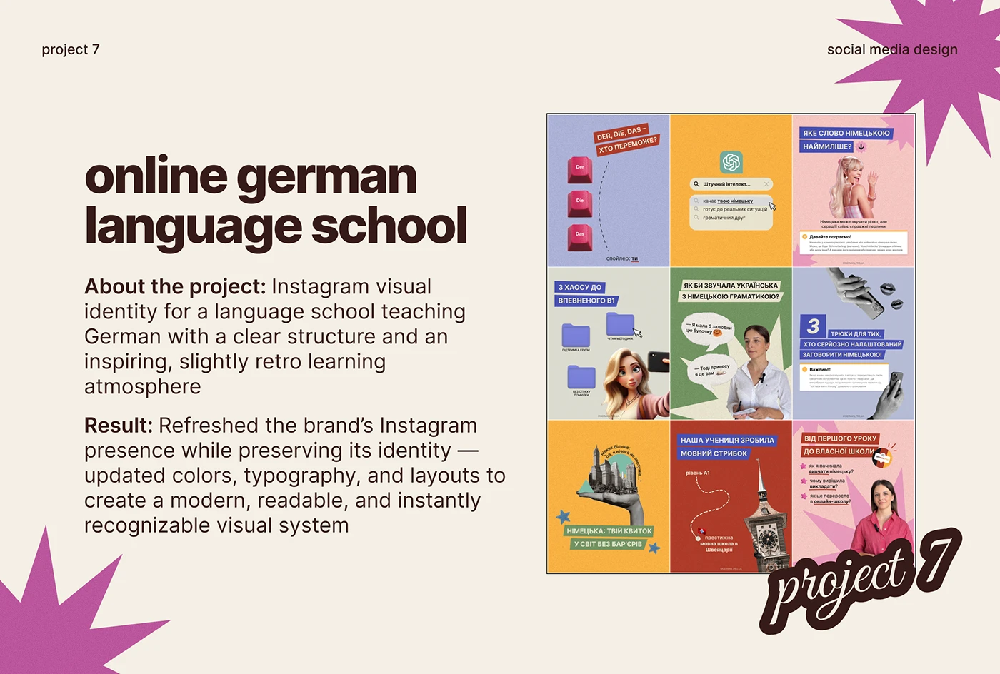

# Project slide with feed grid, bold-lead text and magenta starbursts on cream

**Discipline:** print-social · **Design type:** Presentation slides
**Tags:** case-study, social-media, cream, magenta, starburst, script-sticker, feed-grid, brown-type

## What it is
A cream slide with tiny corner labels, a giant heavy brown title, description paragraphs with bold lead-ins, a 3x3 feed grid of colourful posts at right, big magenta starbursts in two corners and a script outline sticker 'project 7'.

## What it means
Warm and professional; the magenta accent and script sticker add personality.

## Techniques
- Show a 3x3 feed grid as a boxed image next to text.
- Anchor corners with large magenta starbursts.
- Use bold lead-ins for About and Result.
- Overlap a script sticker on the image corner.

## Best for
- Social media case-study slides
- Portfolio project pages
- Designer decks

## Vocabulary
- **Feed-grid tile** — A 3x3 grid image summarising a feed.
- **Corner burst** — A large shape cropped in a slide corner.
- **Script sticker** — A handwritten outlined label.
- **Bold lead-in** — A bold phrase opening a paragraph.
