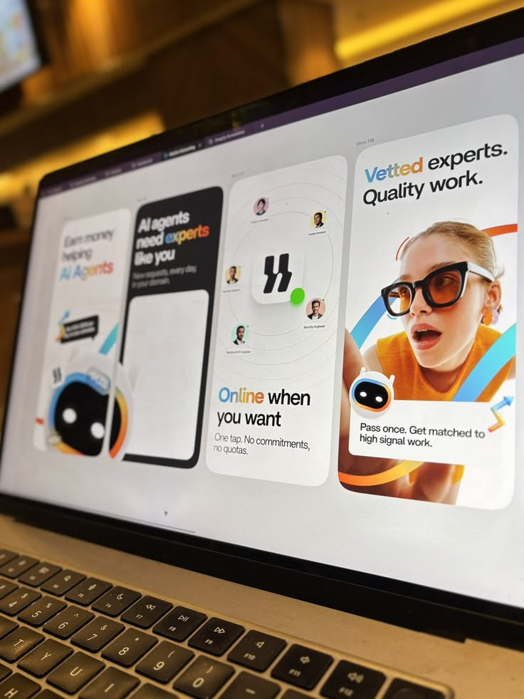

# AI Expert Marketplace Story Frames on a Laptop

**Discipline:** print-social · **Design type:** Story set
**Tags:** stories, ai, mascot, colourful, laptop-photo, white, gradient-type

## What it is
A tilted photo of a laptop showing four vertical story frames for an AI expert marketplace: a white frame with gradient-word headline and a robot mascot, a black frame with a blank card, a white frame with orbiting expert avatars around a brand mark and a photo frame of a woman in glasses with arcs and a mascot chip.

## What it means
Colourful gradient words and a friendly robot make an AI service feel human, and showing the frames in a working file adds authenticity.

## Techniques
- Gradient colour on key headline words
- Robot mascot as a recurring character
- Orbiting avatars around a brand mark
- Curved colour arcs around a photo
- Photo of a screen in a warm cafe setting

## Best for
- AI and marketplace story sets
- Behind-the-scenes design shots
- Mascot-led social campaigns

## Vocabulary
- **Gradient word** — A word filled with a colour gradient in a headline.
- **Orbit layout** — Items arranged in rings around a centre.
- **Screen photo** — A photograph of a design on a monitor.
