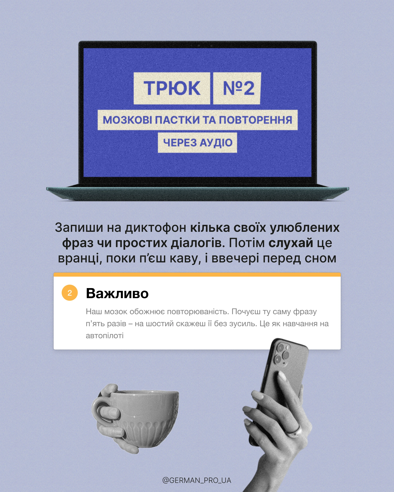

# Tip post with laptop-screen title, white note card and greyscale hands

**Discipline:** print-social · **Design type:** Social educational post
**Tags:** tips, periwinkle, laptop, greyscale-cutout, white-card, orange-accent, grain, cyrillic

## What it is
A 4:5 periwinkle post with a laptop whose screen is a blue panel holding beige label blocks for the headline 'TRICK №2', a two-line explanation, a white note card with an orange top edge and numbered badge, and greyscale cut-outs of a hand with a mug and a hand with a phone.

## What it means
Clear, friendly and study-like; the layout resembles a lesson slide.

## Techniques
- Put the headline on a laptop screen as label blocks.
- Use a white card with a coloured top edge as a note.
- Use greyscale hand cut-outs to add human touch and contrast with colour.
- Add fine grain to unify the elements.

## Best for
- Educational tips and tricks
- Language, study and productivity content
- Series with numbered posts

## Vocabulary
- **Label block headline** — Words on separate rectangles like tape labels.
- **Note card** — A white card with a colour edge highlighting a key point.
- **Greyscale cutout** — A black and white photo of hands or objects.
- **Numbered badge** — A small circle with a number.
