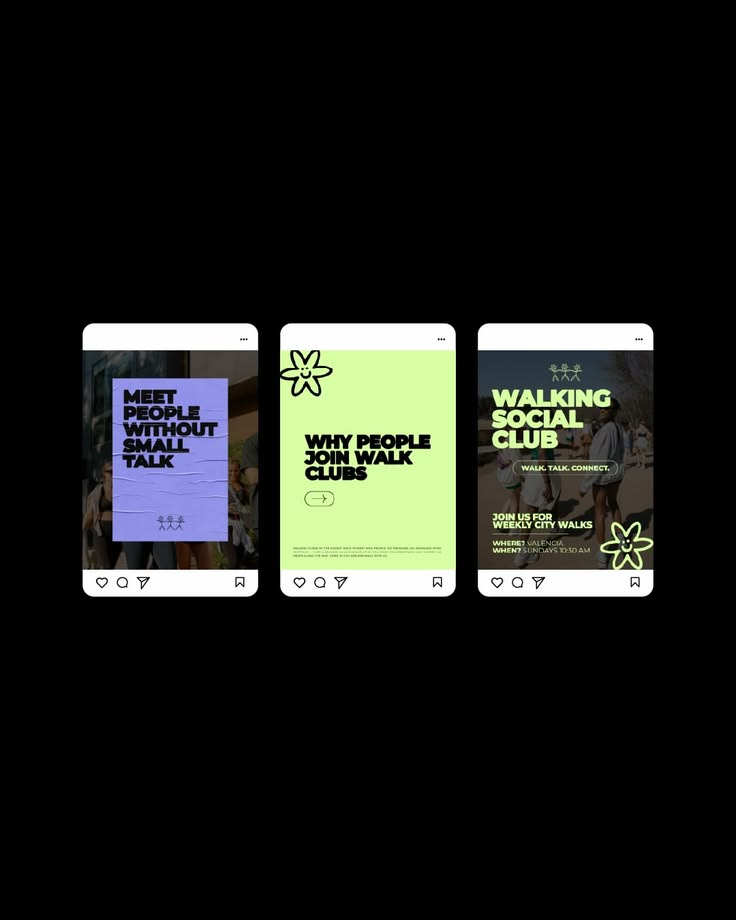

# Walking Club Instagram Trio

**Discipline:** print-social ·  · **Design style:** Playful & Illustrated
**Tags:** instagram, lavender, lime, daisy, black-type, community, posts

## What it is
Three Instagram post frames on black: a crumpled lavender poster over a street photo, a lime post with a smiling flower doodle asking 'Why people join walk clubs', and a photo post with lime headline 'Walking Social Club' and event details.

## What it means
Loud lavender and lime with heavy black type and smiley doodles feel sociable and youthful.

## Techniques
- Crumpled paper texture on the lavender poster
- Doodled daisy characters as brand elements
- Heavy extended black headlines on flat colour
- Lime type over a darkened photo
- Consistent tiny person-line logo

## Best for
- Community clubs and events
- Lifestyle social feeds
- Youth-oriented campaigns

## Vocabulary
- **Doodle mascot** — A simple hand-drawn character used as a brand accent.
- **Crumpled paper texture** — A wrinkled poster effect applied to a flat layout.
- **Feed trio** — Three posts designed to sit side by side in a feed.
