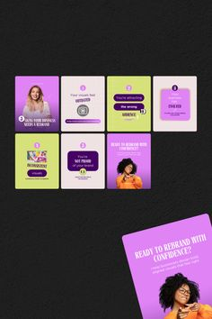

# Small preview of lilac, lime and cream rebrand posts with purple pill headlines

**Discipline:** print-social ·  · **Design style:** Photographic & Cinematic
**Tags:** coaching, lilac, lime, cream, purple, pills, portrait, carousel

## What it is
A dark board with a grid of small square posts in lilac, lime and cream showing purple pill headlines, portrait cutouts and short phrases about rebranding, plus one tilted large card at the corner.

## What it means
Bright and empowering; lilac and lime feel modern and feminine.

## Techniques
- Use purple pills as headline holders.
- Alternate lilac, lime and cream cards.
- Place cutout portraits with the pill.
- Number tips in small circles.

## Best for
- Coaching and branding-service posts
- Small template previews
- Lilac-lime brands

## Vocabulary
- **Pill headline** — A headline inside a capsule.
- **Tilted card** — A card rotated as an accent.
- **Number badge** — A small circle with a tip number.
- **Colour trio** — Three brand colours across a set.
