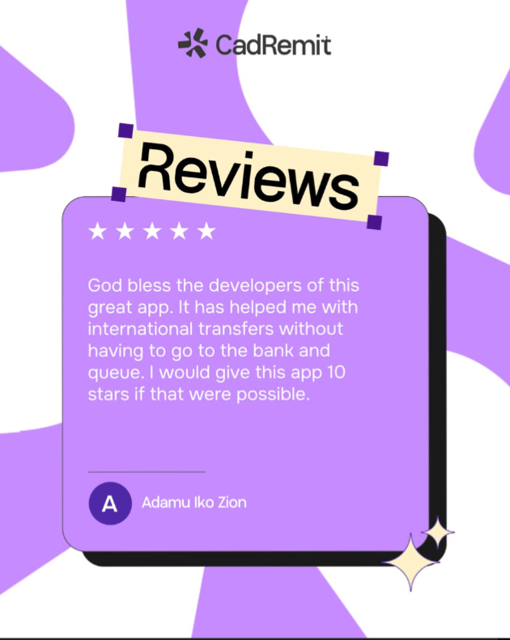

# Lilac Review Card with Offset Shadow

**Discipline:** print-social · **Design type:** Social testimonial post
**Tags:** testimonial, lilac, white, blobs, offset-shadow, five-stars, sparkles, tape-label

## What it is
A portrait testimonial on a white and lilac blob background with a small dark logo, a cream label 'Reviews' tilted like tape with purple corner squares, and a lilac card with a hard black offset shadow holding five stars, a review about international transfers and a purple initial avatar with the reviewer's name, with two cream sparkles at the corner.

## What it means
The hard offset shadow and tape label give a sticker-like, playful feel to a review, and lilac stays friendly.

## Techniques
- Hard offset black shadow behind the card
- Tilted tape-style label with corner squares
- Organic lilac blobs as a background
- Five white stars and an initial avatar
- Cream sparkle accents

## Best for
- Testimonial and review posts
- Fintech social proof
- Playful neo-brutalist cards

## Vocabulary
- **Offset shadow** — A solid shadow shifted from a shape without blur.
- **Tape label** — A label styled like a strip of tape stuck on.
- **Initial avatar** — A round badge showing the first letter of a name.
