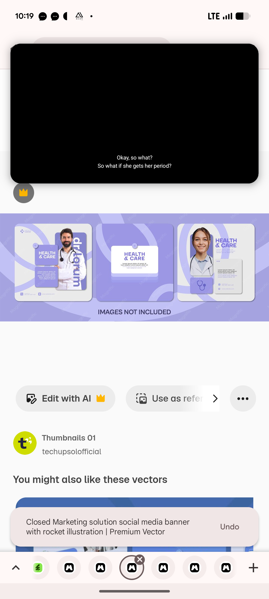

# Lilac Health and Care Post Set with Doctor Cut-Outs

**Discipline:** print-social ·  · **Design style:** Photographic & Cinematic
**Tags:** health, lilac, doctors, cutouts, swoosh, template, medical, stock

## What it is
A stock preview of a lilac health-care post set on a periwinkle band: a post with a bearded doctor cut out beside a rotated 'dr. lorum' label and a lilac headline card, a centre post with a white card 'HEALTH & CARE' on a swoosh background and a post with a woman doctor beside a stethoscope icon tile and a text card.

## What it means
A curving lilac ribbon and cut-out professionals feel trustworthy, and rotated name labels add a small design flourish.

## Techniques
- Cut-out portraits overlapping shape cards
- Rotated name tag along the edge of the photo
- Curved swoosh ribbon behind cards
- Two-tone lilac palette
- Icon tile as a secondary graphic

## Best for
- Healthcare and clinic social posts
- Doctor introduction templates
- Lilac medical brand systems

## Vocabulary
- **Cut-out portrait** — A person masked from a photo and placed over shapes.
- **Rotated tag** — A label turned 90 degrees along a photo edge.
- **Swoosh ribbon** — A curved band used as a background graphic.
