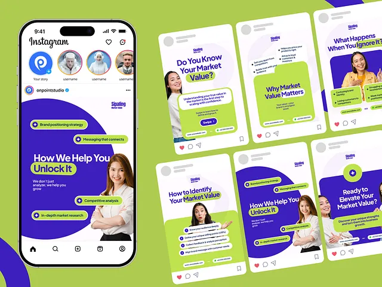

# Lime and indigo consulting carousel with bubble bullets

**Discipline:** print-social ·  · **Design style:** Photographic & Cinematic
**Tags:** instagram, carousel, lime, indigo, consulting, bubble-bullets, photo-cutout, phone-mockup

## What it is
A lime green background with an Instagram phone at left showing a post 'How We Help You Unlock It' and six square posts at right. Each has an indigo arch or circle shape, a cut-out professional, bold headline, and lime pills with plus icons as bullet points.

## What it means
Energetic, trustworthy and educational; consistent shapes make a service feel systematic.

## Techniques
- Use big indigo curves that cut across a white card as a repeating device.
- Turn bullets into pill labels with plus icons.
- Highlight one keyword in a lime block.
- Cut people out and let them overlap the shape edges.

## Best for
- Consulting, marketing and B2B carousels
- Service explainers
- Educational thought-leadership content

## Vocabulary
- **Pill bullet** — A list item styled as a rounded label.
- **Curve device** — A large arc shape repeated across posts.
- **Cutout overlap** — A person breaking the edge of a shape.
- **Carousel system** — A set of posts sharing structure.
