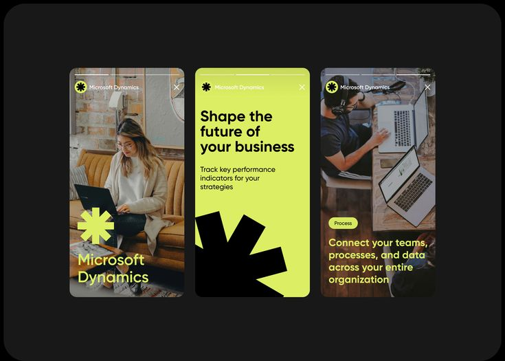

# Lime and Black Asterisk Story Trio

**Discipline:** print-social ·  · **Design style:** Corporate & Clean-Tech
**Tags:** stories, lime, black, asterisk, photography, business, brand-mark, trio

## What it is
A dark board of three vertical stories with a lime asterisk brand mark: a woman working on a laptop with a big lime asterisk and brand name, a lime story 'Shape the future of your business' with a giant black asterisk at the corner, and an overhead photo of two laptops with a lime headline about connecting teams and data.

## What it means
One bold lime mark and colour repeated across photos and flat colour keeps three different stories unmistakably one brand.

## Techniques
- Giant asterisk used as a graphic in every story
- Lime headline over a darkened photo
- Solid lime story with black text and mark
- Story chrome with progress bars and brand row
- Overhead desk photo for variety

## Best for
- Business software social stories
- Bold single-symbol brand systems
- Lime and black story sets

## Vocabulary
- **Brand asterisk** — A star-like mark used as a logo and graphic.
- **Story chrome** — Progress bars and header of a story frame.
- **Flat colour story** — A story built only from solid colour and type.
