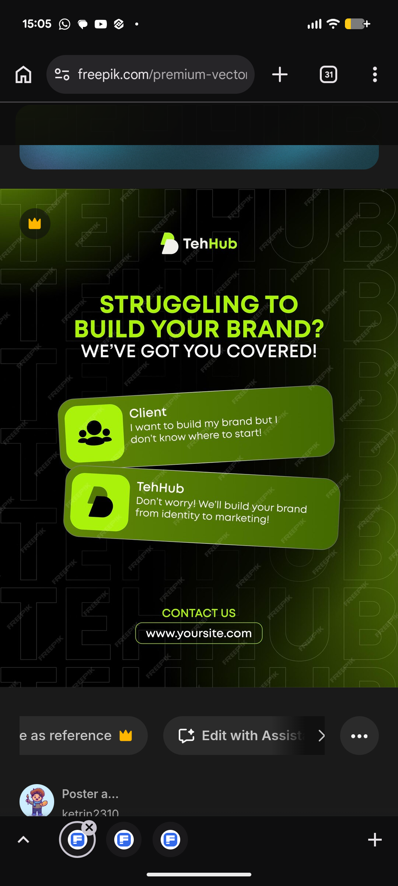

# Struggling to Build Your Brand Post

**Discipline:** print-social · **Design type:** Social ad
**Tags:** lime, black, chat, tilted-cards, ghost-type, agency, headline, vector

## What it is
A dark square post covered in giant outlined ghost letters of a brand name, with a logo row, a lime headline 'STRUGGLING TO BUILD YOUR BRAND?' and a white line 'WE'VE GOT YOU COVERED!', two tilted olive-green chat cards (a client question and the agency reply) with lime icon tiles, and a CONTACT US label with an outlined URL pill.

## What it means
A two-message dialogue shows a problem and answer in seconds, and tilting the cards makes it feel like a live chat.

## Techniques
- Problem line then payoff line in two colours
- Two tilted chat cards as a dialogue
- Lime icon tiles for client and agency
- Outline ghost lettering across the background
- Gradient of olive green at the corners

## Best for
- Agency and service ads
- Problem and solution posts
- Dark lime social templates

## Vocabulary
- **Dialogue card** — A card representing one side of a conversation.
- **Problem/payoff headline** — A question followed by a reassuring answer.
- **Ghost lettering** — Large faint letters used as a background.
