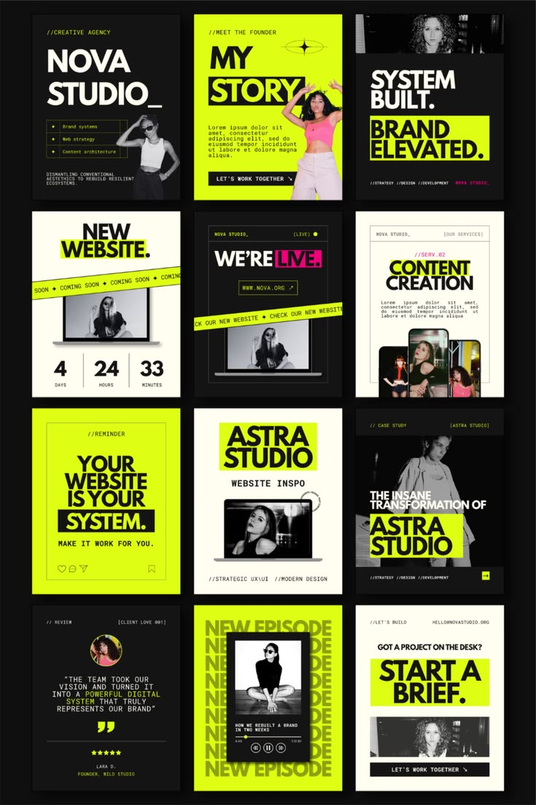

# Lime, Black and Cream Studio Template Grid

**Discipline:** print-social · **Design type:** Social template pack
**Tags:** templates, lime, black, cream, monospace, highlight-blocks, studio, grayscale-photos

## What it is
A dark board with twelve portrait templates for a creative studio in lime, black and cream: intro, story, tagline, coming-soon countdown, we're live, services, reminder, case study, quote, new episode and brief posts, using heavy condensed type on highlight blocks and grayscale photos.

## What it means
Neon lime with black and cream feels bold and modern, and grayscale photos let the colour do the talking.

## Techniques
- Heavy condensed caps with lime highlight blocks
- Monospace labels with slashes as metadata
- Grayscale photography throughout
- Diagonal tape strips reading Coming Soon
- Countdown boxes with hairline dividers

## Best for
- Creative and design studio social kits
- Template marketplace previews
- Bold three-colour systems

## Vocabulary
- **Highlight block** — A solid coloured rectangle behind headline words.
- **Caution tape strip** — A diagonal band of repeated text used as decoration.
- **Mono label** — Small monospace text used as a technical caption.
