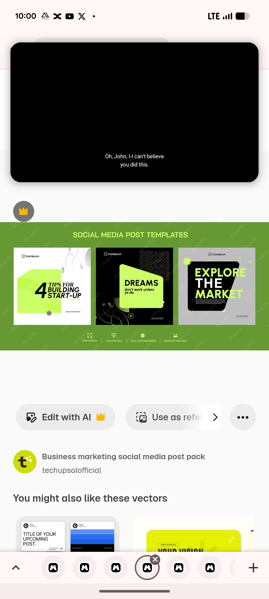

# Lime, Black and Grey Business Post Pack

**Discipline:** print-social ·  · **Design style:** Corporate & Clean-Tech
**Tags:** template-pack, lime, black, grey, angular-cards, typography, business, stock

## What it is
A green-backed stock preview of three square posts: a white post '4 TIPS FOR BUILDING START-UP' with a lime angular card and faint line art, a black post 'DREAMS don't work unless yo do.' with a lime card and repeating ghost words, and a grey post 'EXPLORE THE MARKET' on a black slanted card, with feature icons below.

## What it means
A lime slanted card carries the message in every colourway, so black, white and grey versions still belong together.

## Techniques
- Lime angular card as the shared element
- Three colourways of the same card system
- Repeating ghost word lines behind a headline
- Sparkle and dot accents
- Feature icons listing size, editable and layered

## Best for
- Business and start-up social packs
- Motivational post templates
- Lime and black brands

## Vocabulary
- **Colourway** — A version of a layout in a different colour scheme.
- **Slanted card** — A card whose edges are cut at an angle.
- **Ghost word repeat** — The same word repeated in faint type as texture.
