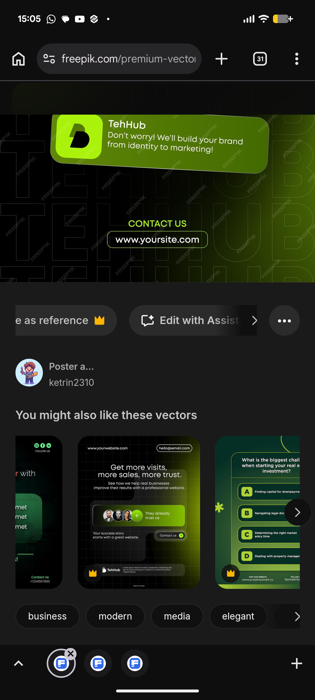

# Lime Glass Chat Cards on Ghost Lettering

**Discipline:** print-social · **Design type:** Social ad
**Tags:** lime, green, dark, glass, chat, ghost-type, contact, vector

## What it is
A stock-vector preview of a dark social post with giant outlined ghost letters of a brand name, a tilted olive-lime glass card with a lime logo tile and the reply 'Don't worry! We'll build your brand from identity to marketing!', a lime CONTACT US label and an outlined website pill.

## What it means
Speech-bubble cards turn a service pitch into a conversation, and lime on black is energetic.

## Techniques
- Giant outlined brand letters as a texture
- Tilted glass cards used as chat bubbles
- Lime logo tile as an avatar
- Outlined pill for the website call to action
- Lime gradient rising from a corner

## Best for
- Agency and brand-service social posts
- Conversation-style ads
- Dark lime social templates

## Vocabulary
- **Outline lettering** — Large letters drawn as thin outlines with no fill.
- **Chat card** — A card styled like a message bubble to deliver a pitch.
- **Outlined pill** — A capsule drawn as an outline for a link.
