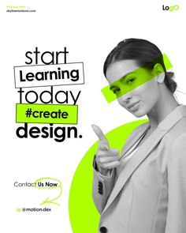

# Course flyer with monochrome portrait, lime bars and a lime circle

**Discipline:** print-social ·  · **Design style:** Photographic & Cinematic
**Tags:** flyer, education, lime, black-and-white, portrait, highlight-bars, handwritten-circle

## What it is
A white portrait flyer with a greyscale woman pointing at the viewer, a lime bar over her eyes, a large lime circle behind, and a headline 'start Learning today #create design.' where words sit in outlined boxes or lime blocks. Contact details are handwritten-underlined.

## What it means
Bold, direct and youthful; the pointing gesture and lime highlight say 'this is for you'.

## Techniques
- Use a cutout monochrome portrait with direct gesture as the call to action.
- Highlight words with lime rectangles and outline boxes.
- Layer a big lime circle behind the subject.
- Add a hand-drawn loop around the contact call.

## Best for
- Course and workshop flyers
- Social ads for training
- Design-school promotions

## Vocabulary
- **Highlight bar** — A coloured rectangle across a face or word.
- **Direct gesture** — A pointing pose addressing the viewer.
- **Outlined word box** — A word inside a thin border.
- **Hand-drawn loop** — A scribbled circle emphasising text.
